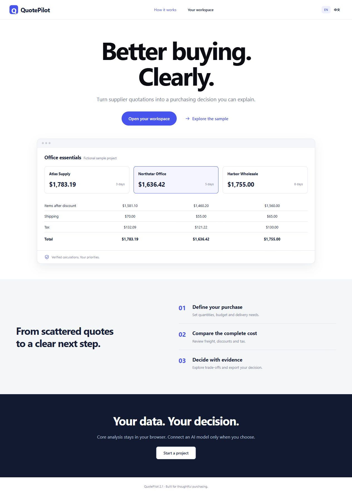
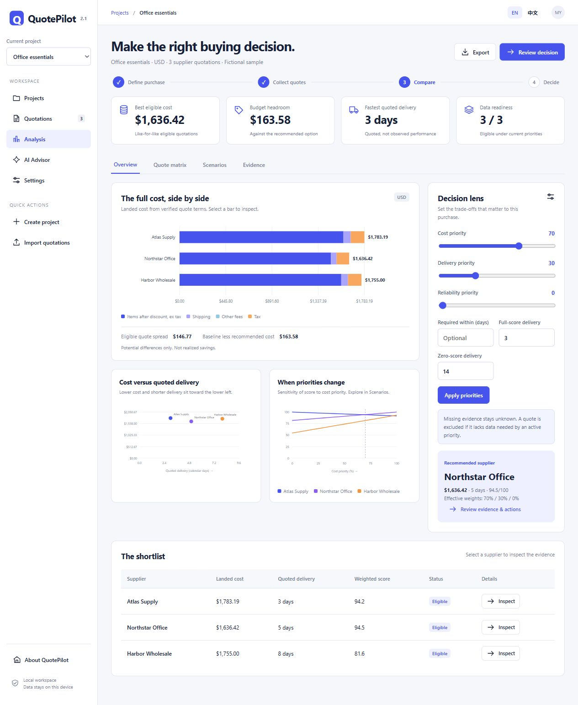
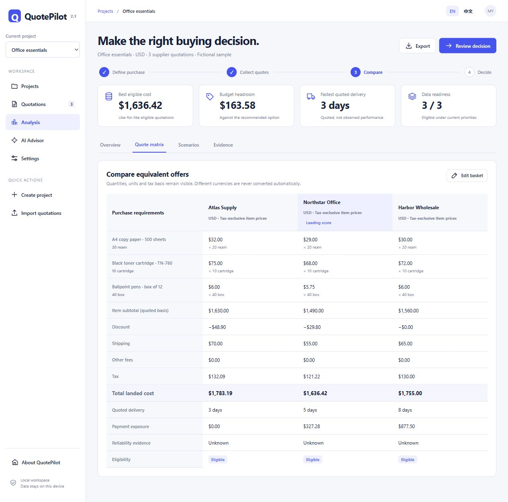
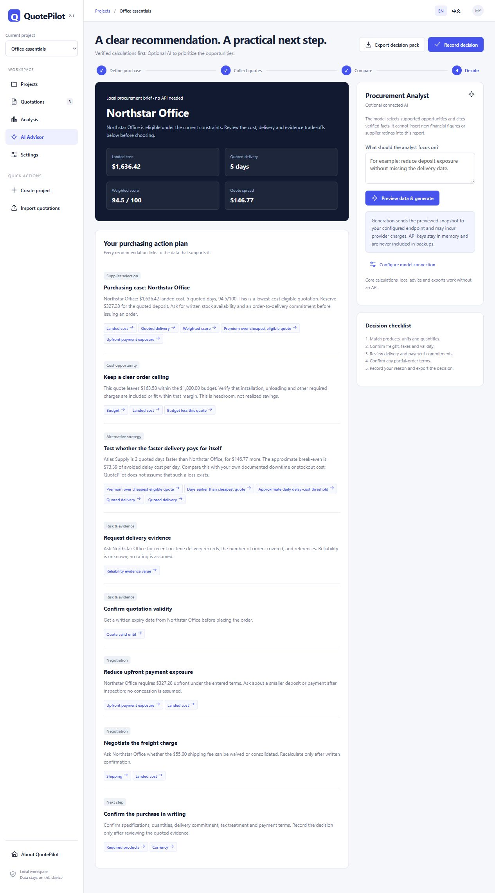

# QuotePilot v2.1

**Procurement decisions grounded in comparable quotations, complete costs, and explicit business priorities.**

QuotePilot helps small businesses turn supplier spreadsheets into a purchasing decision they can explain. It combines quotation import and review, consistent product matching, landed-cost calculations, interactive comparison charts, and actionable purchasing advice in a browser-based application.

The core application works offline without an account, server, or AI subscription. English is the default interface language; Simplified Chinese is also supported. This submission preserves the released v2.1 application and adds documentation and actual application screenshots.

## Product tour

The screenshots below were captured from the running v2.1 application using its fictional **Office essentials** sample. They are stored in this project and embedded with relative Markdown image paths; none are design mockups.

### Landing page

A clear starting point for opening a workspace or exploring the built-in sample.



### Procurement dashboard

Review landed costs, budget headroom, quoted delivery, eligibility, and how purchasing priorities change the recommendation.



### Supplier comparison

Compare required quantities and unit prices alongside discounts, freight, tax, payment exposure, and eligibility. Different SKUs, specifications, units, or quantities are not silently treated as equivalent offers.



### AI Advisor

Read a calculation-backed purchasing case, negotiation actions, evidence gaps, and alternative strategies. This screenshot shows the **local procurement brief**, which requires no API; it is not evidence of a live external AI response.



## Core features

| Capability | What it provides |
| --- | --- |
| Purchasing projects | Create, duplicate, archive and manage projects with optional budgets, delivery requirements and purchase baskets. |
| Excel and CSV import | Recognize English/Chinese headers, select worksheets, review mappings and correct quotations before saving. Preserve numeric precision, leading-zero text SKUs and Excel date systems. |
| Comparable products | Match purchasing SKU and specification, then verify units and quantities. Names are used when both SKUs are blank. No fuzzy SKU matching or automatic pack conversion. |
| Complete cost calculation | Include quantities, discounts, shipping, other fees and configured tax treatment using exact decimal rounding. |
| Transparent recommendations | Rank eligible offers by user-defined cost, delivery and evidence-backed reliability priorities. Explain exclusions and preserve unknown reliability. |
| Interactive analysis | Explore cost breakdowns, delivery comparisons, sensitivity to priorities and whole-line split-order scenarios. |
| Procurement advice | Show supplier-specific business cases, budget gaps, deposit exposure, negotiation evidence and conditional delivery trade-offs. |
| Optional AI connection | Support compatible Chat Completions or Responses endpoints, with an explicit outgoing-data preview and validated fact/action references. |
| Export and local storage | Export XLSX, comparison CSV and readable HTML reports; print reports to PDF; back up and restore the local workspace. |

## Installation and launch

### Recommended: open locally

1. Download or clone the submitted project, or extract the accompanying submission ZIP.
2. Keep the project folders together.
3. Double-click **Open QuotePilot.html** at the project root, or open **dist/index.html** in a modern browser.
4. Choose **Explore the sample**.

**Success indicator:** the dashboard shows Atlas Supply, Northstar Office and Harbor Wholesale, with Northstar's sample landed cost of **$1,636.42**. There is no build step, package installation or terminal command required for end users.

The existing [private hosted application](https://quotepilot-procurement-ttk.humble-field-3507.chatgpt.site) is also available to users who already have access. An AgentGit submission link does not grant access to that separate private website; the included local application is self-contained.

### Static hosting

Serve the contents of **dist/** from any suitable static web host. All runtime assets, including SheetJS, are bundled locally. The application has no backend and does not synchronize browser workspaces. A stable HTTPS origin generally offers more predictable AI endpoint CORS behavior than opening a local file.

## Typical purchasing workflow

1. **Create a project.** Enter its name and currency. Advanced requirements are optional; the first quotation can initialize an empty purchase basket.
2. **Import quotations.** Choose an XLSX or UTF-8 CSV file, then confirm the worksheet, header row and column mappings. Map Product or SKU, Quantity and Unit price. If a supplier column is mapped, fill it on every data row.
3. **Review supplier terms.** Open each quotation and verify purchasing SKU, specification, unit, quantity, prices, currency, freight, discount, tax, validity, delivery and payment terms. Mark it reviewed only after checking the data.
4. **Compare equivalent offers.** Open Analysis and the Quote matrix. Resolve readiness warnings before relying on a ranking. Set priorities and, if useful, explore split-order or sensitivity scenarios.
5. **Review the purchasing case.** Read the local brief in AI Advisor. Inspect the linked evidence and confirm outstanding conditions. Connected AI is optional.
6. **Record and export.** Save the selected supplier and business reason, then export the decision pack. The recorded decision is a dated snapshot, not a purchase order or spending approval.

**Success indicator:** eligible suppliers have consistent basket coverage; the recommendation and export use the same selected supplier and verified amounts. The fictional sample totals are **Atlas $1,783.19**, **Northstar $1,636.42**, and **Harbor $1,755.00**.

Sample import files are included in [dist/samples](dist/samples). Detailed rules and edge cases are covered in the [user guide](docs/USER-GUIDE.md).

## API configuration

The app remains fully usable without a connected model. To configure an optional provider:

1. Open **Settings → AI model connection**.
2. Enter the **complete endpoint URL**, matching protocol, provider's **model ID**, timeout and optional API key. Use the exact model ID supplied by your provider; no particular model is bundled or guaranteed.
3. Choose **Save connection**, then **Test saved connection**. The probe sends a small JSON test prompt and no procurement data; provider charges may still apply.
4. In **AI Advisor**, enter an optional focus and choose **Preview data & generate**. Review the endpoint, model and full outgoing snapshot, then explicitly confirm sending it.
5. Use **Forget key**, close the page, or reload when finished. Reloading clears the in-memory key.

**Success indicators:** the connection probe displays “Connection test passed”; a full valid report displays “AI-prioritized · evidence checked” with the model and generation time. A successful probe alone does not verify full report generation.

| Protocol | Example complete endpoint | Request behavior |
| --- | --- | --- |
| Chat Completions | `https://api.openai.com/v1/chat/completions` | Non-streaming messages; `max_completion_tokens: 2000`. |
| Responses | `https://api.openai.com/v1/responses` | Instructions plus input; `max_output_tokens: 2000`; `store: false`. |
| Compatible custom endpoint | Provider-specified complete URL | Must support the selected request/response schema, output contract and browser CORS. |

These are configuration examples, not claims that a particular external provider or model has been tested. HTTPS is required except for loopback local endpoints. URLs containing embedded credentials, query strings or fragments are rejected; redirects are refused. There is no shared public proxy. Some providers do not accept the documented token-limit fields or browser requests; those configurations require an appropriate user-managed relay or a compatible endpoint.

### API security and unverified functionality

**Authenticated external-provider connections and real-model report generation remain unverified.** No live credential was available for the v2.1 delivery tests or this submission. Both protocols were tested with controlled local responses, including authentication failures, timeouts, malformed output, cancellation and unsupported factual claims. Those tests do not establish compatibility with every provider, model, CORS policy or billing account.

API keys stay in memory, are bound to the saved endpoint, and are excluded from workspace storage, backups and exports. Changing endpoints clears the previous key. Memory-only keys are still accessible to the page and potentially to browser extensions or a compromised browser; this is not a credential vault. Production provider keys should be held by your own authenticated backend or relay. Never commit a real key or put it in an endpoint URL.

The [Procurement Analyst Skill](dist/skills/procurement-analyst/SKILL.md) uses verified calculations and a supported opportunity catalog. Model output is restricted to eligible supplier, action and fact identifiers. The app rejects unknown identifiers and generated financial prose, and renders recommendations from its calculation-backed templates. Suppliers' notes and evidence are treated as untrusted input. Local advice remains available if a request fails.

## Data, calculation rules and limitations

- Quotation processing and deterministic analysis run in the browser. Only an explicitly confirmed AI request sends the previewed data to the configured endpoint.
- Data is stored per browser and origin. Hosted and local copies have separate storage. Use **Settings → Download backup** before moving devices or clearing browser data.
- Matching is conservative: SKU case/punctuation and specification details matter. Equivalent vendor codes or differently worded specifications require buyer review. No exchange-rate or unit conversion is performed.
- Discounts and freight are quotation-level charges. Tax handling uses the single entered rate and selected taxable components. Unknown reliability is never replaced by an invented rating.
- Budget headroom, quote spread and baseline comparisons are potential differences, not realized savings. A faster-delivery threshold does not assert that the buyer actually incurs downtime losses.
- Split scenarios allocate complete product lines, require confirmed partial-order terms, and are not global optimization results.
- Limits: 100 projects, 50 quotations and 500 products per project; 500 imported data rows, 550 worksheet rows and 100 columns; 10 MB import files and 20 MB backups.
- PDF/OCR, live ERP synchronization, multi-user approval, automatic purchase orders and partial quantities within a product line are outside v2.1.

## Testing and submission verification

The project includes **70 automated tests** covering cost calculations, imports, date systems, SKU/specification matching, splits, storage, API handling, supported AI output and exports. Developer-only command:

```sh
node --test tests/*.test.cjs
```

No `npm install` is required to run the bundled application or these Node tests. Node.js is needed only for developer testing or regenerating sample files with `node make-samples.cjs`.

The [verification notes](docs/TESTING.md) distinguish prior browser tests, simulated API checks and unverified external-provider behavior. The [submission verification](docs/SUBMISSION.md) records file integrity, screenshot provenance and the manual publication scope. Third-party SheetJS code and its license are retained under [dist/vendor](dist/vendor).

## Project structure

```text
README.md                 Product and submission entry point
Open QuotePilot.html      Double-click launcher
dist/                     Complete offline/static application
  index.html              Direct application entry point
  engine.js               Cost, matching and eligibility rules
  importer.js             Cell-aware Excel/CSV normalization
  analyst.js              Grounded advice and API integration
  samples/                Fictional CSV/XLSX procurement data
  vendor/                 Bundled SheetJS and license
docs/
  screenshots/            Four actual application captures
  USER-GUIDE.md            Detailed operating and calculation rules
  TESTING.md               Test evidence and remaining limits
  SUBMISSION.md            Submission scope and integrity checks
tests/                    Automated regression tests
package.json              Developer test command
make-samples.cjs           Sample-data generator
```

This submission uses explicit AgentGit import, commit/file commit and push operations only. Automatic uploads are not enabled. Application functionality and design are unchanged from the verified v2.1 release.
