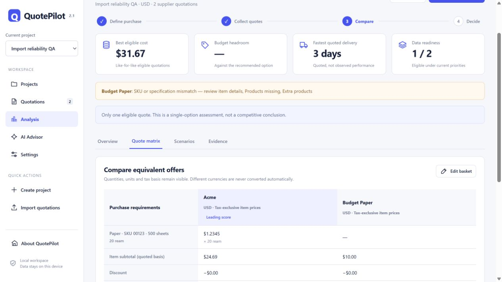
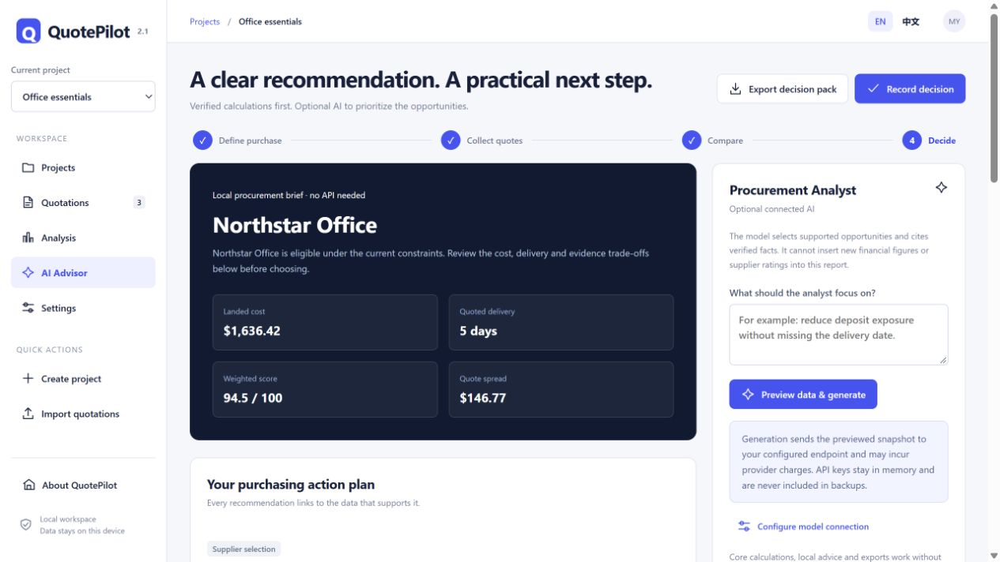

# QuotePilot 2.1

A local-first procurement comparison and decision-support application for small businesses. English is the default; the interface also supports Simplified Chinese. Version 2.1 is a reliability update to 2.0, retaining its interface and static browser architecture.

## Open the application

Use the existing private [QuotePilot web app](https://quotepilot-procurement-ttk.humble-field-3507.chatgpt.site). Access permissions are unchanged. For an offline copy, extract **QuotePilot-v2.1.zip**, open **QuotePilot v2.1**, and double-click **index.html**. No terminal, Node.js installation, or local server is needed for core features. In a source checkout, the entry point is **dist/index.html**.

**Success:** the welcome page opens; choose **Explore the sample** to compare three fictional suppliers immediately. Browser storage belongs to the particular browser and origin. The hosted app and offline file have separate workspaces; move data between them with a backup.

## What changed in 2.1

- Excel imports use underlying cell values, preserving four-decimal unit prices instead of rounded display text. Numeric date cells respect the workbook's 1900 or 1904 date system. Text dates receive explicit ambiguity checks.
- Separate purchasing SKU and specification fields prevent equal product names from hiding different models or pack sizes. The same matching rules drive eligibility, tables, scenarios, and recommendations.
- API keys are bound to the exact saved endpoint, stay in memory, and are excluded from saved settings, backups and exports. Editing settings requires saving before testing. Changing connections invalidates an earlier AI consent preview.
- Advice includes supplier-specific purchase cases, budget gaps or headroom, deposit amounts, negotiation evidence and the approximate daily delay-cost threshold for faster delivery. AI alternatives and exports use the same selected supplier and figures.
- New projects need only a name and currency. Optional requirements are collapsed; the first quotation can initialize the basket. Editing quotation data clears its review confirmation.
- Incomplete split allocations no longer display a partial cost as a complete comparable total. Stale or invalid AI reports fall back to current local advice.

## Complete a comparison

1. Choose **Create project**, enter a name and currency, then **Create & add quotations**. Budget, baseline, delivery requirements and a manual purchase basket are optional under **Purchase requirements**. **Success:** an empty quotation register opens.
2. Choose **Choose file** and select an unencrypted XLSX or UTF-8 CSV. Select the worksheet and header row. Review the recognized columns. Map **Product or SKU**, **Quantity**, and **Unit price**. If the supplier column is mapped, every data row must contain its supplier name; a default name is used only when that column is absent.
3. Review the date order and percentage settings. Choose **Review quotations**, then **Review & edit** for each supplier. Check products, SKU/specification, units, quantities, charges, tax, validity and payment terms; then tick **I reviewed…**. Missing shipping, fees, tax and discount default to zero and require this review. Unknown delivery and payment terms remain blank.
4. Choose **Add to project**. The first supplier initializes an empty basket. Existing quotations are replaced only if you explicitly choose replacement by supplier name; otherwise new quotations are added. **Success:** totals and readiness reasons appear. Resolve any mismatched SKU, specification, unit or quantity before comparison.
5. Open **Analysis → Quote matrix** to inspect comparable line prices and commercial terms. Cost bars and delivery points open supplier details. Adjust the **Decision lens** or explore **Scenarios** before applying priorities. Split scenarios assign whole lines and charge each selected supplier's freight once.
6. Open **AI Advisor** for an actionable local brief. Evidence buttons open the supporting facts. Optional connected AI selects supported actions and cites verified facts. **Record decision** saves your supplier, business reason, amount and dated evidence snapshot; it does not place an order or approve spending.
7. Choose **Export decision pack** for XLSX, comparison CSV, or a readable HTML report. Open the HTML report and choose **Print / save as PDF** for a PDF copy. **Success:** the exported report contains the chosen recommendation, cost rules, evidence and any recorded decision.

## Import and matching rules

**Excel dates:** Following the [SheetJS date model](https://docs.sheetjs.com/docs/csf/features/dates/), actual numeric date cells, including date/time cells, use the workbook date system; the time portion is ignored for expiry. Invalid dates, including Excel's fictional 1900-02-29, are rejected. Numeric strings in CSV are not guessed to be Excel dates. Text dates accept YYYY-MM-DD, YYYY/MM/DD, YYYY.MM.DD and Chinese year/month/day forms. Day-first or month-first dates require a four-digit year. An ambiguous date such as `03/04/2027` stops the import until the user selects the intended date order. Two-digit years and locale-dependent month names are rejected.

**Precision and identifiers:** numeric cells retain stored precision; values with more than four meaningful decimal places must be corrected rather than silently rounded. Text SKUs retain leading zeros; numeric SKUs with a simple zero-padded Excel format such as `00000` preserve that padding. General-format numeric identifiers cannot recover zeros already lost in Excel. Store long identifiers as text. Error cells and formulas without cached results stop the import. Cached formula results produce a warning: recalculate and save the workbook first; QuotePilot does not execute spreadsheet formulas or macros.

**Percentages:** `8` means 8%, `0.5` means 0.5%, and a formatted `8%` cell remains 8%. Enable the fractions option only when unformatted source rates use `0.08` for 8%. Shipping, fees, discounts and taxes are quotation-level terms; repeated values must agree. Duplicate column mappings and conflicting commercial terms are rejected. One imported supplier name represents one quotation; import separate revisions separately.

**Product identity:** when a SKU is present on either side, both must have the same purchasing SKU, including case and punctuation. Names may differ when SKU and specification agree. When both SKUs are blank, normalized product names must agree. Specifications must always agree, including when one is missing; case and whitespace are normalized, but numbers, punctuation and pack size are retained. Units and quantities must also agree. Different specifications may share a product name. No fuzzy matching, vendor-code equivalence inference, or unit/pack conversion occurs. Confirm equivalence before editing a vendor's code to the shared purchasing SKU; preserve the original code in the source document or notes. Existing v2 projects without SKU/specification fields continue to use name matching.

## Verified cost and decision rules

Line subtotals are quantity × unit price with exact decimal half-up rounding at the currency's minor unit. Order discounts apply to items once. Tax-exclusive prices add tax to discounted items and the fees marked taxable. Tax-inclusive prices extract embedded item tax; freight and other fees are always entered before tax. Minimum order value uses discounted items excluding tax. One tax rate is supported per quotation; apply consistent accounting treatment across offers. There is no exchange-rate conversion.

USD/EUR/GBP/CNY/CAD/AUD/SGD/HKD use two decimal places; JPY/KRW use zero; KWD/BHD use three. Quantities and unit prices support four decimal places. Zero values are valid where meaningful; blank or negative required numeric fields are rejected.

Eligible offers must be reviewed, cover the same basket, use the project currency, satisfy MOQ/minimum value, validity and hard constraints, and provide information required by active priorities. Missing reliability stays unknown. Historical on-time counts require a source and take precedence over a supplied evidence-backed score. Quoted delivery days are estimates from order placement, not historical performance.

- Cost score = lowest eligible landed cost ÷ supplier cost × 100; a zero-cost quote scores 100.
- Delivery score = 100 through the target day, declining linearly to zero at the configured limit day.
- Reliability = sourced user score, or observed on-time orders ÷ observed orders × 100.
- Final score = normalized weighted average. All-zero weights yield no weighted recommendation. Ties are reported; cost and name order the display.

Split orders require supplier confirmation of partial-order terms; fixed discounts are not inherited automatically. Incomplete or mixed-currency allocations have no comparable total. The cheapest-line allocation is a starting scenario, not an optimizer. Budget headroom, quote spread and baseline comparisons are distinct potential figures, never realized savings.

Fictional sample totals remain **Atlas $1,783.19**, **Northstar $1,636.42**, **Harbor $1,755.00**. Default weights recommend Northstar with **$163.58 budget headroom** and a **$146.77 eligible quote spread**. Atlas offers two fewer quoted delivery days for $146.77 more; its approximate break-even delay cost is **$73.39/day**. The app does not assume your business incurs that loss.

## AI connection and security

1. Open **Settings**. Enter the complete endpoint URL, supported protocol (**Chat Completions** or **Responses**), provider model ID, timeout, and optional key.
2. Choose **Save connection**, then **Test saved connection**. The probe sends only a tiny JSON test prompt, no quotations; provider charges may apply. **Success:** “Connection test passed.” Saving settings alone sends no request.
3. In **AI Advisor**, enter an optional focus and choose **Preview data & generate**. Inspect the exact destination, model and snapshot. Tick the send confirmation only when appropriate, then generate. **Success:** the report says **AI-prioritized · evidence checked** and its evidence links resolve.
4. Use **Forget key** after testing, or close/reload the page. A key is never stored in localStorage, files or backups. Changing the endpoint clears the previous key unless you explicitly enter a new one.

Memory-only is **not secure server-side secret storage**: this page, browser extensions or a compromised browser can access an in-memory key. For production, use your own authenticated relay holding the provider key on its server. Never share a provider key or enter it into an untrusted endpoint. This static application does not ship a public proxy or a credential vault. The [provider's key-safety guidance](https://help.openai.com/en/articles/5112595-best-practices-for-api-key-safety) recommends keeping keys on a backend.

HTTPS is required except for loopback local models. Endpoint URLs cannot contain embedded credentials, query strings or fragments. Redirects are refused; browser cookies and referrers are omitted from API requests. The endpoint must permit browser CORS. Direct-file mode can have stricter CORS requirements. Chat requests use `max_completion_tokens: 2000`; Responses uses `max_output_tokens: 2000` and `store: false`. Providers must accept the selected schema; not every nominally compatible endpoint supports every model or parameter. Cancellation, timeouts, HTTP failures and invalid output leave local analysis available. Responses are capped at 500 KB; requests are not silently retried.

The integrated [Procurement Analyst Skill](../dist/skills/procurement-analyst/SKILL.md) supplies a verified opportunity catalog and fact identifiers. The model may select an eligible alternative and order up to 12 actions, citing up to 8 facts including the selected supplier's total. Unknown IDs, additional fields and generated factual prose are rejected. Supplier names, notes and evidence are treated as untrusted input. The app renders the business recommendations from verified templates and amounts; it does not accept invented ratings or savings. Current safety and business-case actions may supplement the AI's selection.

## Storage and limits

Quotations remain in this browser unless exported or explicitly included in an AI request. The previewed snapshot includes supplier names, verified facts, entered notes and evidence sources; the selected provider's data policies apply. Hosting does not synchronize projects between devices. Browser quota failures show an in-memory-only warning. Conflicting tabs are prevented from silently overwriting each other.

Use **Settings → Download backup** regularly. Restore accepts v1 and v2 backups, replacing the current workspace after confirmation and clearing the key. Existing v2 storage is reused; v1 migration preserves the old storage key and marks old quotations for review. Decisions and AI reports become stale after relevant changes or a new local calendar day. The activity log and backups are not tamper-proof audit records.

Limits: 100 projects; 50 quotes and 500 basket items per project; 500 imported data rows; 550 worksheet rows including headings and 100 columns; 10 MB quotation files; 20 MB backups. Unsupported: PDF/OCR, exchange-rate conversion, mixed tax rates within a quote, partial quantities within a line, live ERP synchronization, team approval and automatic purchase orders.

## Verification and source layout

**70 automated tests** cover exact cost calculations, legacy migration, XLSX/CSV, both Excel epochs, text-date ambiguity, SKU/spec matching, split scenarios, API transport errors and protocols, endpoint-bound keys, storage/backup exclusion, consent invalidation, AI evidence validation and export consistency. Run `node --test tests/*.test.cjs` in a source checkout (developer-only; users do not need Node.js).

Browser checks exercised the simplified setup, XLSX import/review, CSV date correction, mismatch exclusion, calculation details and workbook downloads. The downloaded workbook was reopened to verify dates, leading-zero SKU, specifications and four-decimal prices. Additional viewport and API verification results are recorded in [testing notes](TESTING.md). **Authenticated external provider testing remains unverified:** the user could not complete credential configuration during this session. Both protocols were tested against a controlled local fixture, not a real model provider.

`dist/` is the complete deployable/offline application. `engine.js` owns calculation and matching, `importer.js` owns cell-aware import normalization, `analyst.js` owns grounded advice and API validation, and the remaining scripts render forms, charts and exports. No build step or runtime CDN is required. SheetJS CE 0.20.3 is bundled with its license. `node make-samples.cjs` regenerates the fictional sample files. Original design/product research is retained in [research notes](RESEARCH.md); its v2.0 design audit is historical.

## Current interface

